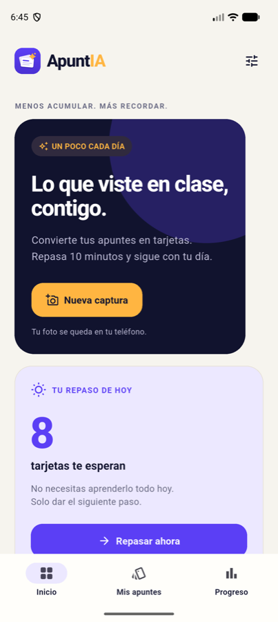
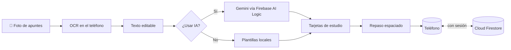

<p align="center">
  
</p>

<h1 align="center">ApuntIA</h1>

<p align="center">
  <strong>App de estudio con inteligencia artificial: de la foto de tus apuntes a tarjetas de repaso.</strong><br>
  Flutter · Android · iOS · Firebase · Gemini · OCR · Repetición espaciada
</p>

<p align="center">
  
  
  
  
  
  
</p>

**ApuntIA** es una aplicación móvil de código abierto, hecha con **Flutter**, para estudiantes. Toma una foto de tus apuntes, la app lee el texto **en el propio teléfono (OCR)** y lo convierte en **tarjetas de estudio (flashcards)**, con plantillas o con **IA generativa (Gemini)**. Después te ayuda a repasar con **repetición espaciada** y guarda tu progreso en la nube con **Firebase**.

<p align="center">
  
</p>

> *English:* ApuntIA is an open-source Flutter study app for Android and iOS that turns photos of class notes into AI-generated flashcards (Gemini via Firebase AI Logic) with on-device OCR and spaced repetition. Contributions are welcome!

---

## Contenido

- [Qué hace](#qué-hace)
- [Cómo funciona](#cómo-funciona)
- [Tecnologías](#tecnologías)
- [Primeros pasos](#primeros-pasos)
- [Conectar tu propio Firebase](#conectar-tu-propio-firebase)
- [Estructura del proyecto](#estructura-del-proyecto)
- [Cómo contribuir](#cómo-contribuir)
- [Hoja de ruta](#hoja-de-ruta)
- [Licencia](#licencia)

## Qué hace

| Función | Descripción |
|---|---|
| 📸 **Captura de apuntes** | Foto o galería. El texto se reconoce en el teléfono (ML Kit en Android, Vision en iOS); la foto no se sube a ningún servidor. |
| ✨ **Tarjetas con IA** | Gemini propone preguntas y respuestas a partir de tu texto. También hay un modo sin conexión con plantillas. Siempre puedes editar antes de guardar. |
| 🔁 **Repaso espaciado** | Marcas *Fácil* o *Difícil* y la app decide cuándo volver a mostrar cada tarjeta (1, 3, 7, 14, 30 y 60 días). |
| 📈 **Progreso** | Racha de días, repasos de la semana y porcentaje de respuestas fáciles. |
| ☁️ **Cuenta y nube** | Inicio de sesión con Google o correo; tus mazos se sincronizan entre teléfonos. Sin cuenta, todo funciona en el dispositivo. |

## Cómo funciona



La idea clave: **el teléfono es la fuente principal**. La nube es una copia que se combina con los datos locales al iniciar sesión, así la app nunca depende de tener internet para estudiar.

## Tecnologías

| Capa | Herramienta |
|---|---|
| Interfaz | Flutter 3.47 · Dart 3.13 · Material 3 |
| OCR | Google ML Kit (Android) · Apple Vision (iOS) |
| IA | Firebase AI Logic con Gemini (`gemini-3.5-flash-lite`) |
| Cuentas | Firebase Authentication (Google y correo) |
| Nube | Cloud Firestore con reglas por usuario |
| Seguridad | Firebase App Check |

## Primeros pasos

**Requisitos:** Flutter 3.47 o superior, Android Studio (Android) y Xcode (iOS, solo en macOS).

### 1. Clona el proyecto

```bash
git clone https://github.com/mlopezgl/ApuntIA.git
cd ApuntIA
```

### 2. Copia las plantillas de configuración

El repositorio **no incluye datos privados**. En su lugar trae plantillas `*.example.*` con textos `AQUI_COLOCA_...`. Para empezar, cópialas con su nombre real:

```bash
cp lib/firebase_options.example.dart lib/firebase_options.dart
cp android/app/google-services.example.json android/app/google-services.json
cp ios/Runner/GoogleService-Info.example.plist ios/Runner/GoogleService-Info.plist
cp ios/Flutter/Secrets.example.xcconfig ios/Flutter/Secrets.xcconfig
```

### 3. Ejecuta

```bash
flutter pub get
flutter run
```

Con las plantillas sin llenar la app funciona en **modo sin conexión**: captura, tarjetas con plantillas y repaso. Es suficiente para trabajar en la interfaz o la lógica de estudio. Para la cuenta, la nube y la IA, conecta tu propio Firebase.

## Conectar tu propio Firebase

1. Crea un proyecto en [Firebase](https://console.firebase.google.com).
2. Genera tu configuración con [FlutterFire CLI](https://firebase.google.com/docs/flutter/setup); esto reemplaza las plantillas por tus datos reales:
   ```bash
   flutterfire configure --platforms=android,ios
   ```
3. En la consola de Firebase activa:
   - **Authentication** → proveedores *Google* y *Correo electrónico/contraseña*.
   - **Firestore Database** → crea la base de datos y publica las reglas incluidas:
     ```bash
     cp firebase.example.json firebase.json   # llena AQUI_COLOCA_...
     cp .firebaserc.example .firebaserc       # llena AQUI_COLOCA_...
     firebase deploy --only firestore
     ```
   - **AI Logic** → *Gemini Developer API*.
4. **App Check (necesario para la IA):** registra un token de depuración en *App Check → Apps → ⋮ → Administrar tokens de depuración*, cópialo en `config/dev.json` (usa `config/dev.example.json` como base) y ejecuta:
   ```bash
   flutter run --dart-define-from-file=config/dev.json
   ```
5. **Inicio de sesión con Google en Android:** agrega la huella SHA‑1 de tu clave de firma en la app Android de Firebase.
6. **iOS en un iPhone real:** escribe tu *Team ID* y el `REVERSED_CLIENT_ID` en `ios/Flutter/Secrets.xcconfig`.

> 🔒 Los archivos reales (`firebase_options.dart`, `google-services.json`, `GoogleService-Info.plist`, `Secrets.xcconfig`, `config/*.json`) están en `.gitignore`. **Nunca los subas.**

## Estructura del proyecto

```text
lib/
├── domain/      # Modelos y reglas de repaso (sin dependencias de Flutter)
├── data/        # Almacenamiento local y estado de la app
├── services/    # OCR, IA (Gemini), cuenta y sincronización con Firebase
└── ui/          # Pantallas y componentes
test/            # Pruebas unitarias y de widgets
integration_test/# Prueba de punta a punta contra Firebase
firestore.rules  # Reglas de seguridad de la base de datos
```

Comandos útiles:

```bash
flutter analyze                     # análisis estático
flutter test                        # pruebas
dart run tool/domain_check.dart     # comprobaciones rápidas de la lógica
```

## Cómo contribuir

¡Toda ayuda suma! Puedes reportar errores, proponer ideas o enviar código. Lee la [guía de contribución](CONTRIBUTING.md) y busca issues con la etiqueta **good first issue** para empezar.

Ideas donde puedes aportar:

- Inicio de sesión con **Facebook** y **Apple** (ya están preparados en `lib/services/auth_config.dart`).
- Traducción de la interfaz al **inglés**.
- **Modo oscuro**.
- Exportar e importar mazos.
- Más pruebas de widgets.

## Hoja de ruta

- [x] OCR en el dispositivo (Android e iOS)
- [x] Tarjetas con IA (Gemini) y modo sin conexión
- [x] Repaso espaciado y estadísticas
- [x] Cuenta con Google y correo, sincronización en la nube
- [ ] Inicio de sesión con Apple y Facebook
- [ ] Notificaciones de repaso
- [ ] Interfaz en inglés
- [ ] Publicación en Google Play y App Store

## Licencia

Distribuido bajo la licencia **MIT**. Consulta [LICENSE](LICENSE).

Creado por **Mónica López González** ([mlopezgl](https://github.com/mlopezgl)).
